

<a href="https://nikhil-rana-portfolio.vercel.app"><picture><source media="(prefers-color-scheme: dark)" srcset="assets/cards/hero-dark.svg">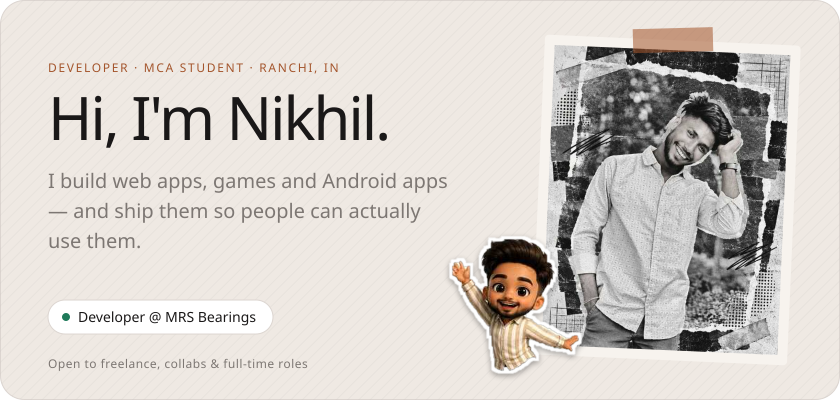</picture></a>

<a href="https://nikhil-rana-portfolio.vercel.app"><b>Portfolio</b></a> &nbsp;·&nbsp; <a href="https://linkedin.com/in/nikhilrana27"><b>LinkedIn</b></a> &nbsp;·&nbsp; <a href="https://nova-hop.vercel.app/"><b>Play Nova Hop</b></a> &nbsp;·&nbsp; <a href="https://github.com/nikhilrana2715?tab=repositories"><b>All repos</b></a>

 

<picture><source media="(prefers-color-scheme: dark)" srcset="assets/cards/sec-about-dark.svg"></picture>
<picture><source media="(prefers-color-scheme: dark)" srcset="assets/cards/about-dark.svg">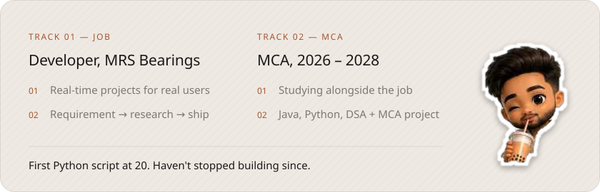</picture>

 

<picture><source media="(prefers-color-scheme: dark)" srcset="assets/cards/sec-work-dark.svg"></picture>
<a href="https://nova-hop.vercel.app/"><picture><source media="(prefers-color-scheme: dark)" srcset="assets/cards/p-nova-hop-dark.svg">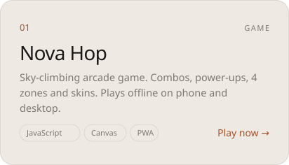</picture></a>&nbsp;<a href="https://running-game-91zr.vercel.app/"><picture><source media="(prefers-color-scheme: dark)" srcset="assets/cards/p-funny-jump-dark.svg">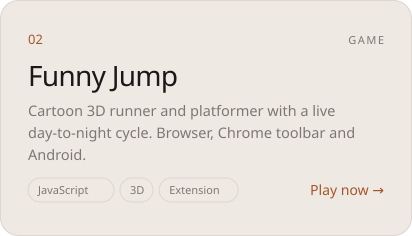</picture></a>
<a href="https://nikhil-rana-portfolio.vercel.app"><picture><source media="(prefers-color-scheme: dark)" srcset="assets/cards/p-mma-dark.svg">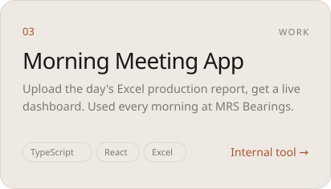</picture></a>&nbsp;<a href="https://github.com/nikhilrana2715/Locker"><picture><source media="(prefers-color-scheme: dark)" srcset="assets/cards/p-quick-lock-dark.svg">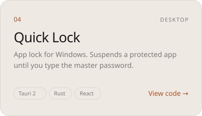</picture></a>
<a href="https://github.com/nikhilrana2715/App-Lock"><picture><source media="(prefers-color-scheme: dark)" srcset="assets/cards/p-applock-dark.svg">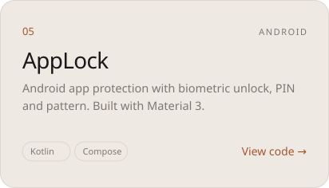</picture></a>&nbsp;<a href="https://taskflow-pro-xi-blush.vercel.app"><picture><source media="(prefers-color-scheme: dark)" srcset="assets/cards/p-taskflow-dark.svg">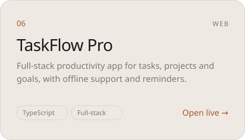</picture></a>

 

<picture><source media="(prefers-color-scheme: dark)" srcset="assets/cards/sec-toolkit-dark.svg">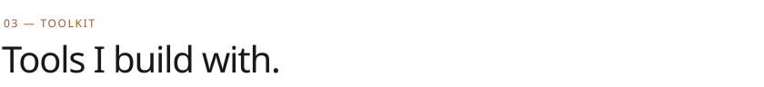</picture>
<picture><source media="(prefers-color-scheme: dark)" srcset="assets/cards/toolkit-dark.svg">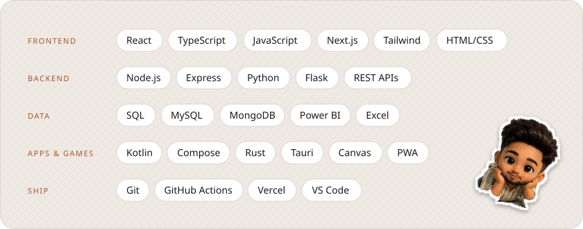</picture>

 

<picture><source media="(prefers-color-scheme: dark)" srcset="assets/cards/sec-field-dark.svg"></picture>
<picture><source media="(prefers-color-scheme: dark)" srcset="assets/cards/field-dark.svg">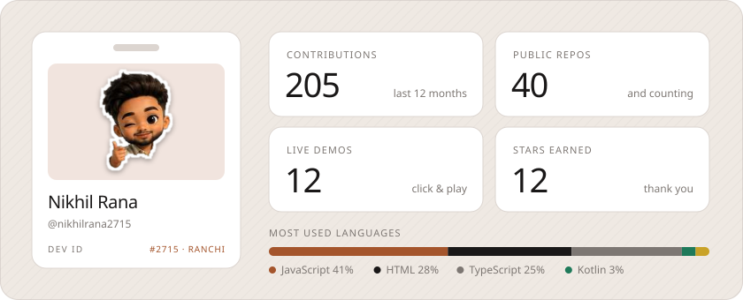</picture>
<picture><source media="(prefers-color-scheme: dark)" srcset="https://raw.githubusercontent.com/nikhilrana2715/nikhilrana2715/output/github-snake-dark.svg"></picture>

 

<a href="https://nikhil-rana-portfolio.vercel.app"><picture><source media="(prefers-color-scheme: dark)" srcset="assets/cards/contact-dark.svg">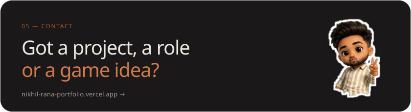</picture></a>

Cards are hand-built SVGs, regenerated daily by <a href="scripts/build_cards.py">a small Python script</a>. Type: Onest &amp; IBM Plex Mono.

